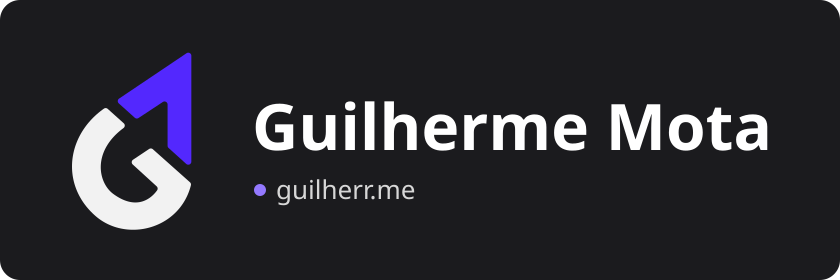

	

# Hi there 👋

My name is Guilherme Mota. I'm currently a Tech Lead at [Letalk](https://letalk.com.br). I'm working mostly with Node.js, Typescript and React.js but I love to know about everything that revolves around technology, so I have some knowledge about Devops and Design as well.

I'm also passionate about open source, so occasionally you will see me giving stars all around the github repositories and developing new projects.

## 👨‍💻 Current Projects

In part of my free time I like to stay focused on some personal projects just for fun/curiosity, and sometimes I write about what I learn along the way.

Everything I'm working on right now lives on my website, so it is always up to date:

> 🚀 [Current projects](https://guilherr.me/#projects) - What I'm building at the moment.
>
> ✍️ [Blog posts](https://guilherr.me/blog) - Things I've been writing about.

## 📫️ How to reach me

If you want to get in touch, you can reach me out on any channels below.

